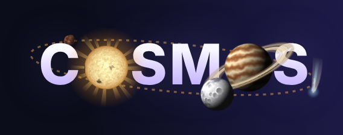
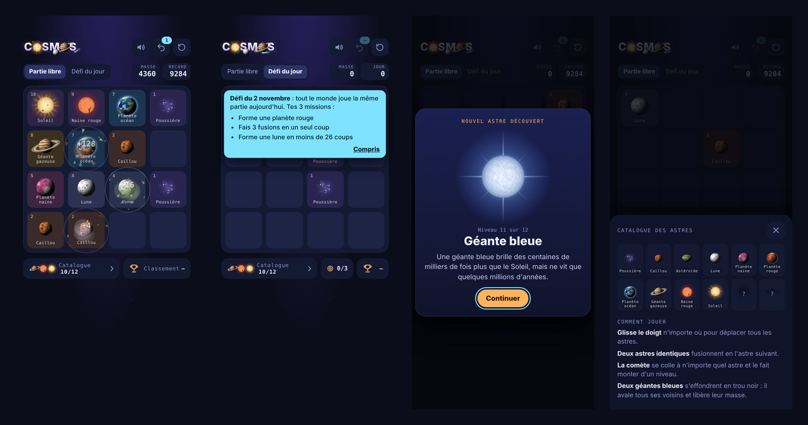
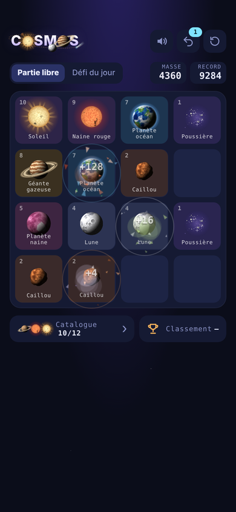
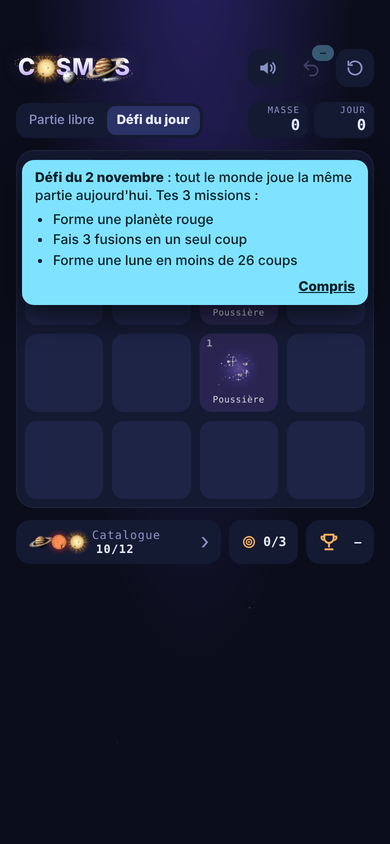
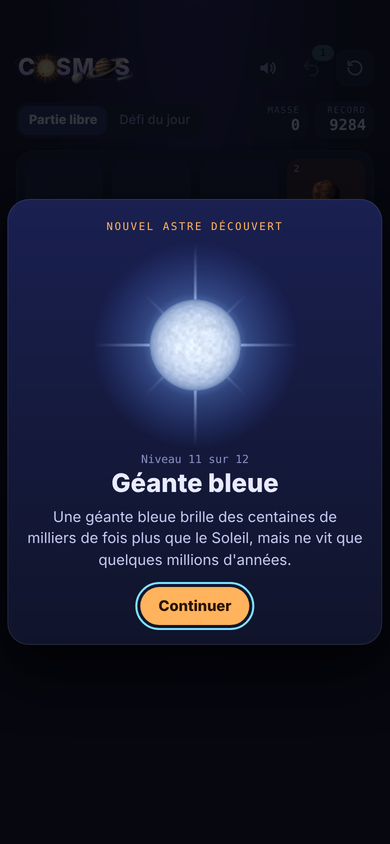
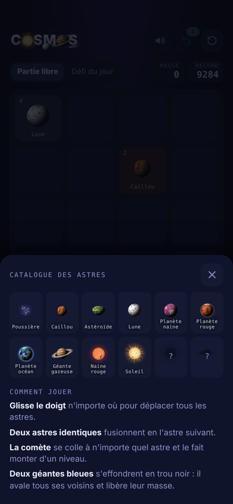

<p align="center">
  
</p>

<p align="center"><b>Un jeu de fusion spatial pour lb-phone (FiveM) et pour le web.</b><br>
Fais grandir la poussière jusqu'au trou noir.</p>

Deux versions dans ce dépôt, avec le même jeu (`ui/index.html`) :

- **FiveM / lb-phone** : la racine du dépôt est la ressource ([installation](#installation)).
- **Web, sur ton téléphone** : le dossier `web/`, prêt pour Render.com ([déploiement](#version-web-sur-rendercom)).



## Le jeu

Glisse le doigt pour déplacer tous les astres. Deux astres identiques se percutent
et fusionnent en l'astre suivant, de la poussière jusqu'au trou noir.

| | |
|---|---|
|  | **12 astres à faire évoluer**<br>Poussière, caillou, astéroïde, lune, planète naine, planète rouge, planète océan, géante gazeuse, naine rouge, soleil, géante bleue, puis trou noir.<br><br>**La comète** est un joker : elle fait monter n'importe quel astre d'un niveau et rapporte une annulation.<br><br>**Le trou noir** naît de deux géantes bleues : il aspire tout le jeu en spirale, l'écran reste noir quelques secondes, puis un message de félicitations s'affiche.<br><br>**Univers suivants** : en partie libre, « Continuer » relance un univers vide en gardant la masse, et chaque fusion y rapporte plus (×1,5 au 2e univers, ×2 au 3e… jusqu'à ×3 au maximum). Chaque univers est aussi plus dur : il démarre avec un ou deux débris de l'ancien univers et les comètes y sont plus rares.<br><br>**Astres exotiques** (univers suivants uniquement) : la **matière noire** (dès l'univers 2) bloque une case quelques coups, de plus en plus souvent et longtemps d'un univers à l'autre ; la **nébuleuse** (dès le 3e) fait monter un astre de 2 niveaux ; le **pulsar** (dès le 4e) change toutes les poussières du plateau en cailloux. Ils ont leur propre section dans le catalogue, et chaque univers a la couleur de son ciel. Chaque fin d'univers a aussi sa propre cinématique surprise. Le classement affiche l'univers atteint. Le défi du jour, lui, s'arrête au premier trou noir pour que tout le monde soit à égalité.<br><br>Chaque fusion a son animation : éclats de roche, anneau de matière pour la géante gazeuse, allumage des étoiles, implosion du trou noir. |
|  | **Défi du jour**<br>Chaque jour, tout le serveur joue exactement la même partie, avec les mêmes apparitions d'astres.<br><br>3 missions tirées au sort pour la journée (former une planète rouge, faire 3 fusions en un coup…), pas d'annulation, et un classement dédié qui affiche les missions réussies. |
|  | **Découvertes**<br>Chaque nouvel astre s'affiche en grand avec une vraie anecdote d'astronomie. |
|  | **Catalogue des astres**<br>Les astres découverts se débloquent un à un, et on peut relire leur fiche à tout moment.<br><br>**Classements** : général et du jour, pour tous les joueurs, avec le pseudo choisi par chacun. |

## Installation

Version FiveM / lb-phone.

1. Clone ce dépôt dans tes ressources (le dossier doit s'appeler `cosmos`) :
   ```
   git clone https://github.com/MattZepolStudio/cosmos.git
   ```
2. Ajoute dans `server.cfg`, **après** `oxmysql` et `lb-phone` :
   ```
   ensure cosmos
   ```
3. Redémarre. Les tables `cosmos_scores` et `cosmos_daily` sont créées automatiquement
   (sinon importe `cosmos.sql`).
4. L'appli apparaît dans l'App Store du téléphone (ou directement sur l'écran
   d'accueil si `Config.DefaultApp = true`).

Dépendances : `lb-phone`, `oxmysql`.

## Le classement

- **Le nom affiché est le pseudo saisi par le joueur**, dans l'onglet Classement
  de l'appli. Tant qu'il n'en a pas choisi, ses scores sont enregistrés mais il
  n'apparaît pas dans la liste (avec `Config.RequirePseudo = true`, réglage par défaut).
- **Un pseudo est unique sur le serveur** (sans tenir compte des majuscules) :
  3 à 16 caractères, lettres (accents compris), chiffres, espace, `_`, `.` et `-`.
  Les mots de `Config.BannedWords` sont refusés. Le joueur peut le modifier à tout moment.
- **Le serveur garde le meilleur score** de chaque joueur (table `cosmos_scores`)
  et son meilleur score de chaque défi du jour (table `cosmos_daily`).
  Le record affiché dans l'appli vient du serveur.
- **Deux classements** : général (meilleur score de tous les temps) et défi du jour
  (meilleur essai de la journée, avec les missions réussies).
- Pour retirer un pseudo inapproprié : `UPDATE cosmos_scores SET pseudo = NULL WHERE pseudo = '...';`

## Réglages (`config.lua`)

- `Config.DefaultApp` : appli installée d'office ou non.
- `Config.BoardSize` : nombre de joueurs dans chaque classement.
- `Config.RequirePseudo` : `true` = seuls les joueurs avec un pseudo apparaissent ;
  `false` = sans pseudo, le joueur apparaît avec `Config.GetDisplayName`.
- `Config.PseudoMinLength`, `Config.PseudoMaxLength`, `Config.BannedWords` : règles des pseudos.
- `Config.MaxScore`, `Config.SubmitCooldown` : garde-fous contre la triche.
- `Config.GetPlayerKey` : une ligne de classement par licence (par défaut) ou par personnage.
- `Config.GetDisplayName` : nom enregistré avec le score, visible en base de données.

### Utiliser le nom du personnage RP

QBCore :
```lua
local QBCore = exports["qb-core"]:GetCoreObject()
Config.GetPlayerKey = function(src)
    local p = QBCore.Functions.GetPlayer(src)
    return p and p.PlayerData.citizenid or ("src:" .. src)
end
Config.GetDisplayName = function(src)
    local p = QBCore.Functions.GetPlayer(src)
    if not p then return "Joueur" end
    local c = p.PlayerData.charinfo
    return c.firstname .. " " .. c.lastname
end
```

ESX :
```lua
local ESX = exports["es_extended"]:getSharedObject()
Config.GetPlayerKey = function(src)
    local x = ESX.GetPlayerFromId(src)
    return x and x.identifier or ("src:" .. src)
end
Config.GetDisplayName = function(src)
    local x = ESX.GetPlayerFromId(src)
    return x and x.getName() or "Joueur"
end
```
(Ces fonctions ne sont appelées que côté serveur.)

## Ce qui a été optimisé pour le téléphone en jeu

- Les astres sont des images PNG pré-rendues (`ui/img`) : aucune génération au lancement.
- Particules plafonnées et toile d'effets en résolution 1x pour préserver les FPS de GTA.
- L'animation du logo tourne à 30 images/s et se met en pause après 20 s sans interaction.
- Les effets s'arrêtent d'eux-mêmes quand il n'y a plus rien à animer.
- Les licences des autres joueurs ne sont jamais envoyées au téléphone.
- Au repos (plus de 20 s sans toucher l'écran), le jeu ne calcule plus rien : 0 image par seconde.
- Le son s'éteint entre deux effets et dès que l'appli passe en arrière-plan.

## À vérifier sur ton serveur

- **Signature des exports lb-phone** : `AddCustomApp`, `RemoveCustomApp` et
  `SendCustomAppMessage(identifier, action, data)` sont écrits d'après la doc
  lb-phone (Custom Apps). Si ta version diffère, ajuste `client.lua`.
- **Marge du haut** : l'interface laisse 46 px pour la barre d'état du téléphone
  (`.app{padding-block:46px 26px}` dans `ui/index.html`). Ajuste si ça chevauche.
- **Polices** : elles se chargent depuis Google Fonts. Sans internet, le jeu passe
  sur une police système. Pour les embarquer, ajoute les fichiers `.woff2`
  dans `ui/fonts` et remplace le `<link>` par des `@font-face`.
- **Triche** : le score est calculé dans le téléphone. Les garde-fous serveur
  limitent les abus évidents, pas un joueur déterminé.

## Version web sur Render.com

Le dossier `web/` contient un petit serveur Node **sans aucune dépendance** qui sert
le jeu et un classement partagé entre tous ceux qui jouent au lien.
C'est le même fichier de jeu que dans le téléphone FiveM : un pont (`web/public/web-bridge.js`)
remplace les appels au serveur FiveM par des appels à ce serveur.

### Déployer

**Blueprint (le plus simple)**
1. Sur [dashboard.render.com](https://dashboard.render.com), clique sur **New +** > **Blueprint**.
2. Choisis le dépôt **`MattZepolStudio/cosmos`**.
3. Render lit `render.yaml` et prépare le service `cosmos`. Laisse les deux variables
   Upstash vides pour l'instant (voir plus bas) et clique sur **Apply**.

**Web Service manuel**
- **Runtime** : `Node` · **Plan** : `Free`
- **Build Command** : `cd web && npm install`
- **Start Command** : `cd web && npm start`
- **Health Check Path** : `/healthz`

Ton jeu est ensuite en ligne à une adresse du type `https://cosmos-xxxx.onrender.com`.

### Installer sur le téléphone

Ouvre l'adresse dans Chrome (Android) ou Safari (iPhone), puis
**menu ⋮ > Ajouter à l'écran d'accueil** (Safari : **Partager > Sur l'écran d'accueil**).
Cosmos s'ouvre alors en plein écran avec son icône, comme une vraie appli,
et reste jouable sans réseau (seul le classement a besoin du serveur).

### Garder le classement

Le plan gratuit de Render efface le disque à chaque redémarrage ou déploiement.
Pour garder pseudos et scores, comme pour JoSky :
1. Crée une base Redis gratuite sur [upstash.com](https://upstash.com).
2. Dans Render, renseigne `UPSTASH_REDIS_REST_URL` et `UPSTASH_REDIS_REST_TOKEN`.

Sans ces variables, le classement est écrit dans `web/.data/cosmos.json`.

### Bon à savoir

- Le plan gratuit met le serveur en veille après 15 min sans visite :
  la première ouverture peut prendre jusqu'à ~50 s pour le classement.
  Le jeu, lui, se lance tout de suite une fois installé.
- Chaque téléphone reçoit un identifiant secret, gardé dans le navigateur.
  Effacer les données du navigateur crée un nouveau joueur (il faudra un autre pseudo).
- Mots interdits dans les pseudos : variable `COSMOS_BANNED_WORDS`
  (liste séparée par des virgules, par défaut `admin,staff,modo`).

### Lancer en local

```
cd web
npm start
```
puis ouvre http://localhost:3000.
